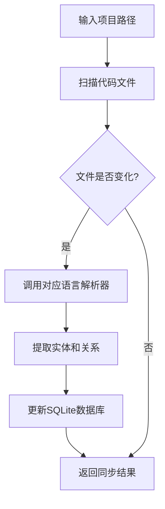

# 全编程语言代码知识图谱系统 - 产品需求文档

## 1. 产品概述

**全编程语言代码知识图谱系统** 是一款基于第一性原理设计的代码智能分析工具，能够自动扫描、解析任意编程语言的项目代码，构建实体（类型、函数）和关系（调用、继承、引用）的知识图谱，并提供直观的可视化界面和智能问答能力。

- **核心价值**：打破语言壁垒，一套系统覆盖所有编程语言的代码结构分析
- **目标用户**：软件开发者、技术负责人、代码审查者
- **市场定位**：代码理解与导航的新范式

## 2. 核心功能

### 2.1 用户角色

| 角色 | 访问方式 | 核心权限 |
|------|----------|----------|
| 访客 | 直接访问 | 浏览图谱、搜索、基础问答 |
| 注册用户 | 邮箱注册 | 创建项目、高级分析、导出报告 |

### 2.2 功能模块

1. **项目扫描与同步**
   - 跨平台文件监控（支持 Linux/macOS/Windows）
   - 多语言解析（Python/Java/JavaScript/ArkTS/Go/C/C++/Rust等）
   - 增量更新机制
   - 防抖合并队列

2. **知识图谱可视化**
   - 力导向图展示代码关系
   - 节点类型区分（类型/函数/模块）
   - 边的类型区分（调用/继承/导入）
   - 缩放、平移、筛选

3. **智能搜索**
   - 按名称搜索实体
   - 按类型过滤（类/函数/接口）
   - 按语言过滤
   - 关系路径查询

4. **AI智能问答**
   - 基于硅基流动LLM的代码问答
   - 代码片段高亮展示
   - 上下文感知回答

### 2.3 页面详情

| 页面名称 | 模块名称 | 功能描述 |
|----------|----------|----------|
| 首页 | 项目列表 | 展示已分析的项目，支持添加新项目 |
| 首页 | 快速统计 | 代码行数、类型数量、函数数量 |
| 图谱页面 | 力导向图 | 交互式代码关系可视化 |
| 图谱页面 | 筛选面板 | 按语言/类型/关系筛选节点 |
| 图谱页面 | 详情面板 | 点击节点显示详细信息 |
| 搜索页面 | 搜索框 | 实时搜索实体名称 |
| 搜索页面 | 结果列表 | 显示匹配的实体及关系 |
| 问答页面 | 对话界面 | AI问答交互区域 |
| 问答页面 | 历史记录 | 保存问答历史 |

## 3. 核心流程

### 3.1 项目创建流程

### 3.2 图谱查询流程

## 4. 用户界面设计

### 4.1 设计风格

- **主题**：深色科技风格 + 霓虹光效
- **主色调**：深空灰 `#0a0a0f`、科技蓝 `#00d4ff`、量子紫 `#8b5cf6`
- **按钮风格**：玻璃态 + 发光边框
- **字体**：
  - 标题：`Orbitron` (科技感)
  - 正文：`JetBrains Mono` (代码友好)
- **布局**：左侧导航 + 主内容区 + 右侧详情面板
- **图标**：Lucide图标库

### 4.2 页面设计概览

| 页面名称 | 模块名称 | 界面元素 |
|----------|----------|----------|
| 首页 | 导航栏 | Logo、项目切换下拉、用户头像 |
| 首页 | 项目卡片 | 项目名、语言分布、更新时间、操作按钮 |
| 图谱页面 | 图谱画布 | D3.js力导向图、节点提示、关系高亮 |
| 图谱页面 | 控制面板 | 缩放按钮、筛选开关、布局切换 |
| 搜索页面 | 搜索框 | 实时搜索、自动补全 |
| 问答页面 | 对话气泡 | 用户消息、AI回复、代码高亮 |

### 4.3 响应式设计

- **桌面优先**：1200px以上最佳体验
- **平板适配**：1024px以下侧边栏收起
- **移动端**：768px以下使用底部导航

## 5. 性能指标

| 代码量 | 全量构建时间 | 数据库大小 | 单文件更新时间 |
|--------|--------------|------------|----------------|
| 10万行 | 30秒 | 5MB | <0.3秒 |
| 100万行 | 8分钟 | 50MB | <0.8秒 |
| 1000万行 | 70分钟 | 500MB | <2秒 |
