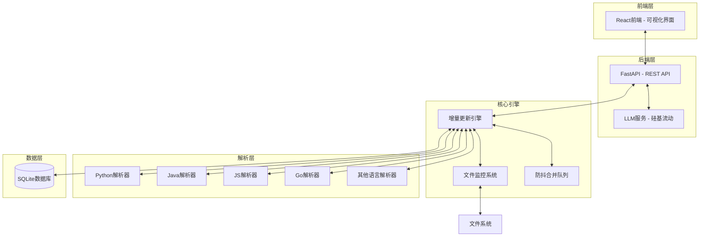
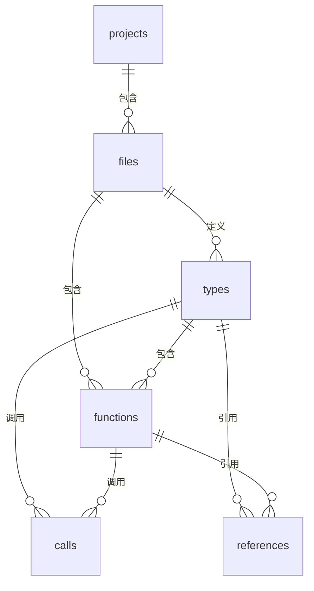

# 全编程语言代码知识图谱系统 - 技术架构文档

## 1. 系统架构设计



## 2. 技术选型

### 2.1 后端技术栈

- **框架**：Python 3.11+ / FastAPI 0.104+
- **数据库**：SQLite3（轻量、零配置、高性能）
- **文件监控**：watchdog（跨平台文件监控）
- **解析器**：
  - Python: `tree-sitter-python`
  - JavaScript/TypeScript: `tree-sitter-typescript`
  - Go: `tree-sitter-go`
  - Java: `tree-sitter-java`
  - Rust: `tree-sitter-rust`
- **LLM集成**：requests（调用硅基流动API）

### 2.2 前端技术栈

- **框架**：React 18 + TypeScript
- **构建工具**：Vite
- **样式**：Tailwind CSS 3
- **图谱渲染**：D3.js 力导向图
- **图标**：Lucide React

## 3. 路由定义

| 路由 | 方法 | 用途 |
|------|------|------|
| `/api/projects` | GET | 获取项目列表 |
| `/api/projects` | POST | 创建新项目 |
| `/api/projects/{id}` | DELETE | 删除项目 |
| `/api/projects/{id}/sync` | POST | 触发同步 |
| `/api/projects/{id}/stats` | GET | 获取项目统计 |
| `/api/graph/{project_id}` | GET | 获取图谱数据 |
| `/api/search` | GET | 搜索实体 |
| `/api/chat` | POST | AI问答 |

## 4. API定义

### 4.1 项目相关

```typescript
// 创建项目
POST /api/projects
Request: { path: string; name: string }
Response: { id: number; name: string; path: string; created_at: string }

// 获取图谱数据
GET /api/graph/{project_id}
Response: {
  nodes: Array<{
    id: number;
    name: string;
    type: 'type' | 'function';
    kind: string;
    file_id: number;
    file_path: string;
  }>;
  links: Array<{
    source: number;
    target: number;
    relation: 'call' | 'inherit' | 'import';
  }>;
}
```

### 4.2 AI问答

```typescript
POST /api/chat
Request: {
  project_id: number;
  message: string;
  history?: Array<{role: string; content: string}>;
}
Response: {
  answer: string;
  sources?: Array<{file: string; line: number; code: string}>;
}
```

## 5. 数据模型

### 5.1 ER图



### 5.2 数据定义语言

```sql
-- 项目表
CREATE TABLE projects (
    id INTEGER PRIMARY KEY AUTOINCREMENT,
    name TEXT NOT NULL,
    path TEXT UNIQUE NOT NULL,
    created_at INTEGER NOT NULL,
    updated_at INTEGER NOT NULL
);

-- 文件表
CREATE TABLE files (
    id INTEGER PRIMARY KEY AUTOINCREMENT,
    project_id INTEGER NOT NULL,
    path TEXT NOT NULL,
    language TEXT NOT NULL,
    hash TEXT NOT NULL,
    modified INTEGER NOT NULL,
    FOREIGN KEY (project_id) REFERENCES projects(id),
    UNIQUE(project_id, path)
);

-- 类型表（类/接口/结构体/枚举）
CREATE TABLE types (
    id INTEGER PRIMARY KEY AUTOINCREMENT,
    file_id INTEGER NOT NULL,
    name TEXT NOT NULL,
    kind TEXT NOT NULL,
    line_start INTEGER,
    line_end INTEGER,
    FOREIGN KEY (file_id) REFERENCES files(id),
    UNIQUE(file_id, name, kind)
);

-- 函数表
CREATE TABLE functions (
    id INTEGER PRIMARY KEY AUTOINCREMENT,
    file_id INTEGER NOT NULL,
    type_id INTEGER,
    name TEXT NOT NULL,
    line_start INTEGER,
    line_end INTEGER,
    FOREIGN KEY (file_id) REFERENCES files(id),
    FOREIGN KEY (type_id) REFERENCES types(id),
    UNIQUE(file_id, type_id, name)
);

-- 调用关系表
CREATE TABLE calls (
    id INTEGER PRIMARY KEY AUTOINCREMENT,
    caller_id INTEGER NOT NULL,
    caller_type TEXT NOT NULL,
    callee_id INTEGER NOT NULL,
    callee_type TEXT NOT NULL,
    FOREIGN KEY (caller_id) REFERENCES types(id),
    FOREIGN KEY (callee_id) REFERENCES types(id)
);

-- 引用关系表
CREATE TABLE references (
    id INTEGER PRIMARY KEY AUTOINCREMENT,
    from_id INTEGER NOT NULL,
    from_type TEXT NOT NULL,
    to_id INTEGER NOT NULL,
    to_type TEXT NOT NULL,
    kind TEXT NOT NULL
);

-- 索引
CREATE INDEX idx_files_project ON files(project_id);
CREATE INDEX idx_types_file ON types(file_id);
CREATE INDEX idx_functions_file ON functions(file_id);
CREATE INDEX idx_functions_type ON functions(type_id);
CREATE INDEX idx_calls_caller ON calls(caller_id);
CREATE INDEX idx_calls_callee ON calls(callee_id);
```

## 6. 核心模块设计

### 6.1 文件监控模块

```python
# 防抖合并队列
class DebouncedQueue:
    def __init__(self, delay_ms: int = 1000):
        self.queue = {}
        self.delay = delay_ms / 1000

    def add(self, file_path: str, event_type: str):
        self.queue[file_path] = event_type

    async def process(self, callback):
        await asyncio.sleep(self.delay)
        events = self.queue.copy()
        self.queue.clear()
        for path, event in events.items():
            await callback(path, event)
```

### 6.2 增量更新引擎

```python
# 单文件更新
async def update_file(project_id: int, file_path: str, event_type: str):
    async with db.transaction():
        if event_type in ('modified', 'deleted'):
            await db.execute(
                "DELETE FROM files WHERE project_id = ? AND path = ?",
                (project_id, file_path)
            )
            await cleanup_relations(file_path)

        if event_type in ('created', 'modified'):
            language = detect_language(file_path)
            parser = get_parser(language)
            result = await parser.parse(file_path)
            await insert_entities(result)
```

## 7. LLM集成

### 7.1 硅基流动API

```python
import requests

class SiliconFlowLLM:
    def __init__(self, api_key: str):
        self.api_key = api_key
        self.endpoint = "https://api.siliconflow.cn/v1/chat/completions"

    def chat(self, messages: list, model: str = "deepseek-ai/DeepSeek-V2.5"):
        response = requests.post(
            self.endpoint,
            headers={
                "Authorization": f"Bearer {self.api_key}",
                "Content-Type": "application/json"
            },
            json={
                "model": model,
                "messages": messages,
                "stream": False
            }
        )
        return response.json()
```

## 8. 目录结构

```
/workspace/
├── backend/
│   ├── main.py              # FastAPI入口
│   ├── config.py             # 配置管理
│   ├── database.py           # 数据库操作
│   ├── models.py             # 数据模型
│   ├── routers/
│   │   ├── projects.py       # 项目API
│   │   ├── graph.py          # 图谱API
│   │   └── chat.py           # 问答API
│   ├── services/
│   │   ├── watcher.py        # 文件监控
│   │   ├── engine.py         # 更新引擎
│   │   ├── parser.py         # 解析器接口
│   │   └── llm.py            # LLM服务
│   └── parsers/
│       ├── base.py           # 解析器基类
│       ├── python_parser.py  # Python解析
│       ├── js_parser.py      # JS解析
│       └── go_parser.py      # Go解析
├── frontend/
│   ├── src/
│   │   ├── App.tsx
│   │   ├── main.tsx
│   │   ├── pages/
│   │   │   ├── Home.tsx
│   │   │   ├── Graph.tsx
│   │   │   └── Chat.tsx
│   │   ├── components/
│   │   │   ├── GraphCanvas.tsx
│   │   │   └── SearchBar.tsx
│   │   └── api/
│   │       └── client.ts
│   └── index.html
└── requirements.txt
```
